# Microsoft Fabric — SFTP Medallion Pipeline

A portfolio project demonstrating a production-style data engineering pipeline built on Microsoft Fabric. The pipeline ingests daily sales data from a local SFTP server, processes it through Bronze, Silver, and Gold layers following the Medallion Architecture, and produces aggregated business-ready Delta tables.

All infrastructure used in this project is free. The SFTP server runs locally on a Windows 11 machine, connected to a Microsoft Fabric Trial workspace via the On-premises Data Gateway.

---

## What This Project Demonstrates

- Connecting Microsoft Fabric to a local SFTP server using the On-premises Data Gateway
- Building a multi-activity Data Factory pipeline with file-level error handling, audit logging, and SFTP archiving
- Transforming raw CSV data into cleaned, validated, and enriched Delta tables using PySpark notebooks
- Aggregating Silver data into four business-ready Gold tables
- Implementing watermarking to track processed files and avoid duplicate loads
- Applying the Medallion Architecture (Bronze, Silver, Gold) end to end

For the SFTP server setup, refer to the companion repository: [sftp-setup-for-fabric-ingestion](https://github.com/RevathyDevarajan/sftp-setup-for-fabric-ingestion)

---

## Architecture

```
SFTP Server (Bitvise, local Windows 11 PC)
        |
        |  SSH / SFTP (port 22)
        v
On-premises Data Gateway  (Gateway-LocalPC)
        |
        |  Secure tunnel to Fabric cloud
        v
PL_Daily_Sales  (Master Pipeline)
        |
        |--- Invoke: PL_Bronze_DailySales_Load
        |--- Notebook: silver_layer_notebook
        |--- Notebook: gold_layer_notebook
```

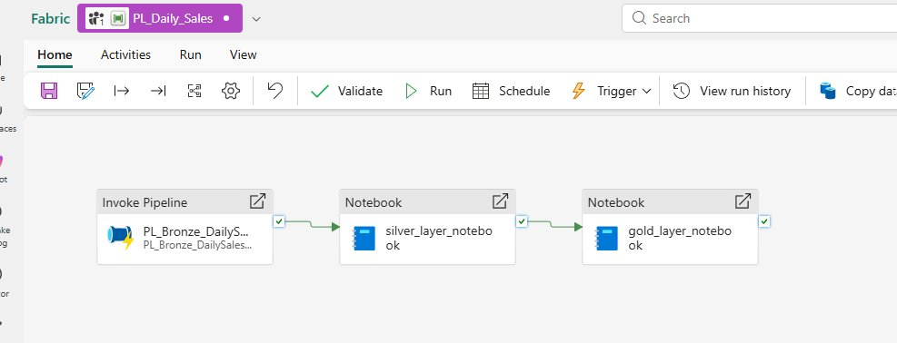

---

## Workspace Overview

The workspace **Daily_Sales_Analytics** contains all pipeline items organised as a task flow from data ingestion through to the Gold analytical layer.

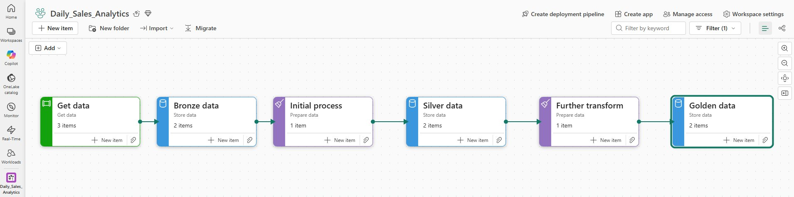

---

## Data Source

Daily sales CSV files are dropped into the SFTP upload folder on the local Windows machine. The pipeline picks up all files present in the folder on each run.

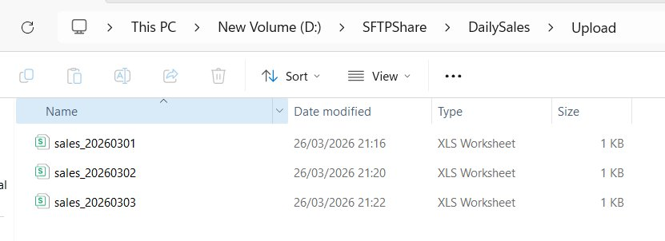

Source location: `D:\SFTPShare\DailySales\Upload\`

File naming convention: `sales_YYYYMMDD.csv`

---

## Medallion Architecture

| Layer | Lakehouse | Description |
|-------|-----------|-------------|
| Bronze | Pulse_Sales_Bronze | Raw files landed from SFTP — no transformations applied |
| Silver | Pulse_Sales_Silver | Cleaned, validated, typed, and enriched Delta tables |
| Gold | Pulse_Sales_Gold | Aggregated, business-ready tables ready for reporting |

---

## Bronze Layer — PL_Bronze_DailySales_Load

The Bronze pipeline handles SFTP ingestion end to end. It lists all files in the upload folder, copies each one to the Bronze Lakehouse, logs the result, and moves processed files to an archive folder.

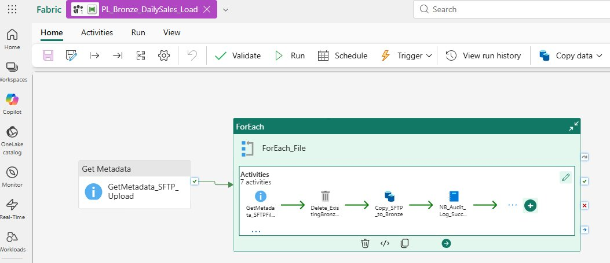

### Pipeline Activities

**GetMetadata_SFTP_Upload**

Lists all child items in the SFTP upload folder. This output feeds the ForEach loop.

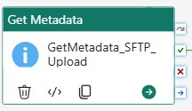

General settings:

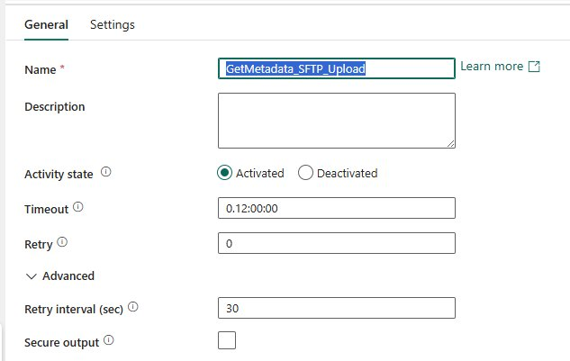

Settings — connection: SFTP_Bitvise, path: /upload, format: Binary, field list: Child items:

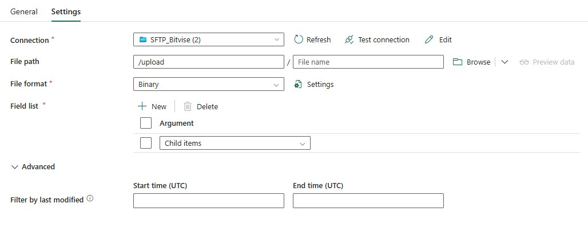

---

**ForEach_File**

Iterates over every file returned by GetMetadata_SFTP_Upload. The inner activities run once per file.

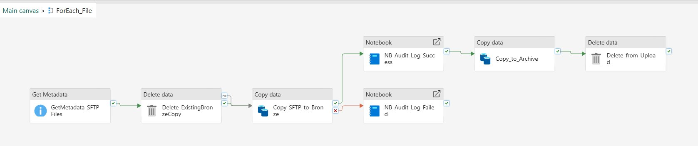

---

**GetMetadata_SFTPFiles** (inside ForEach)

Retrieves item name and last modified time for the current file. These values are passed downstream to the audit notebook as parameters.

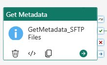

General settings:

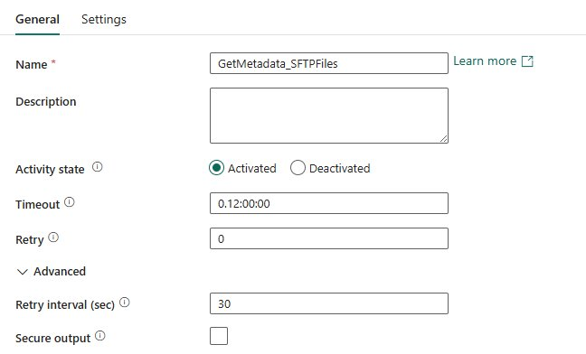

Settings — path: /upload/@item().name, format: DelimitedText, field list: Item name, Last modified:

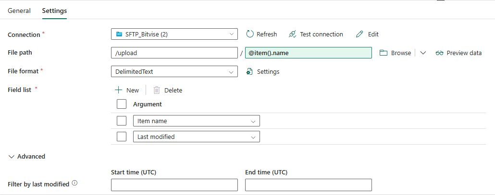

---

**Delete_ExistingBronzeCopy** (inside ForEach)

Deletes any existing copy of the file from the Bronze Lakehouse before writing a fresh version. This ensures the Bronze layer always holds the most recent file without duplicates.

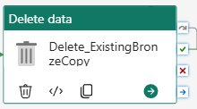

General settings:

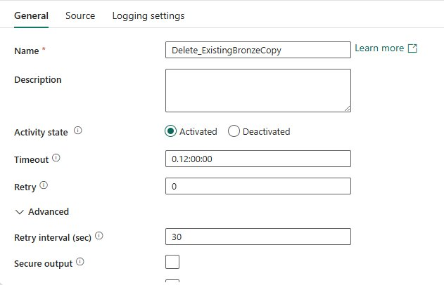

Source — connection: Pulse_Sales_Bronze, path: Files/bronze/@activity('GetMetadata_SFTPFiles').output...:

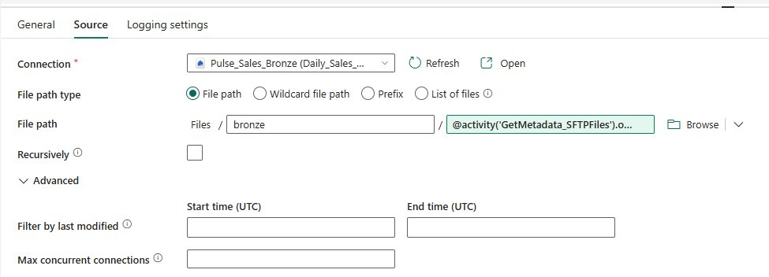

---

**Copy_SFTP_to_Bronze** (inside ForEach)

Copies the file from SFTP to the Bronze Lakehouse. On success, execution branches to the audit success notebook. On failure, it branches to the audit failed notebook.

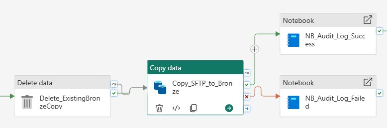

General settings — timeout: 10 minutes per file:

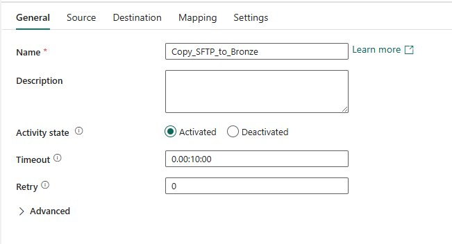

Source — SFTP_Bitvise, path: /upload/@item().name, format: DelimitedText:

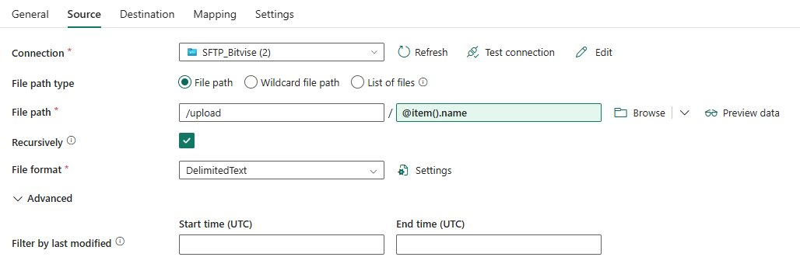

Destination — Pulse_Sales_Bronze, root: Files, path: bronze/sales/@item().name, format: DelimitedText:

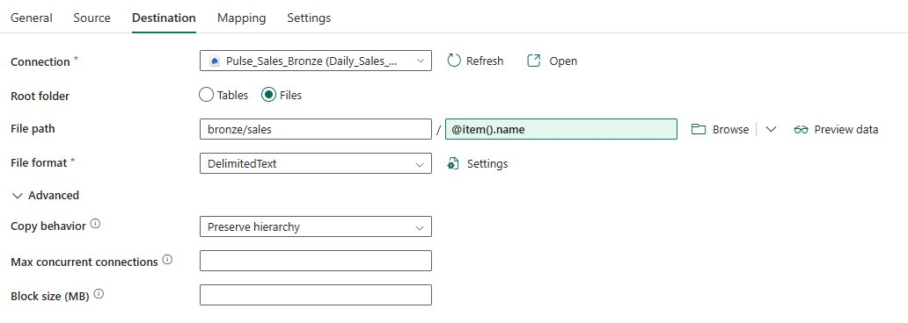

---

**NB_Audit_Log_Success** (inside ForEach — success branch)

Runs notebook NB_02_Audit_Log_Success. Writes a success row to the bronze_audit_log Delta table.

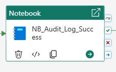

General settings:

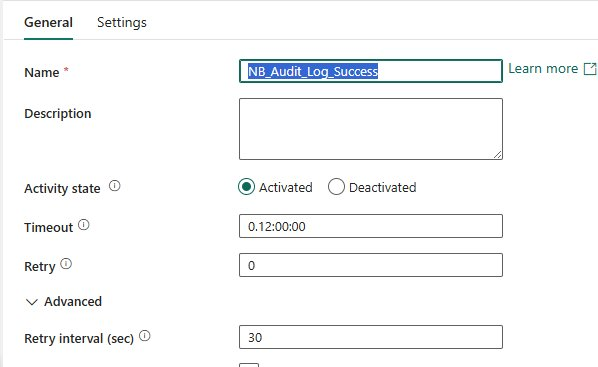

Settings — workspace: Daily_Sales_Analytics, notebook: NB_02_Audit_Log_Success. Parameters passed: p_pipeline_run_id, p_file_name, p_bronze_path, p_FileModifiedTime:

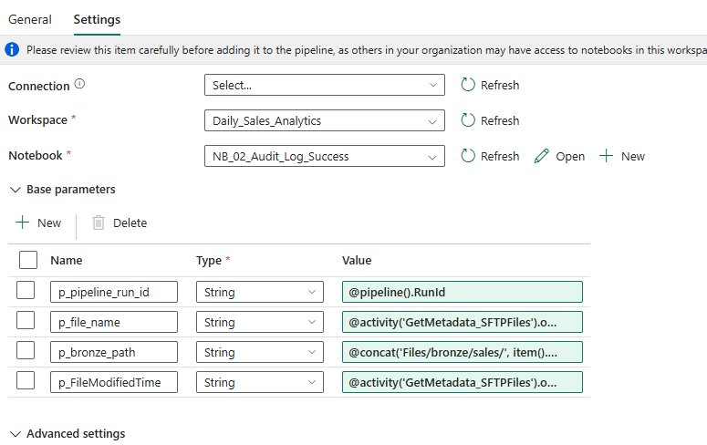

---

**Copy_to_Archive** (inside ForEach — after success audit)

Copies the processed file from the SFTP upload folder to the SFTP archive folder. Runs only after the audit success notebook completes.

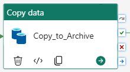

General settings:

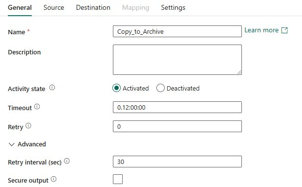

Source — SFTP_Bitvise, path: /upload/@item().name, format: Binary:

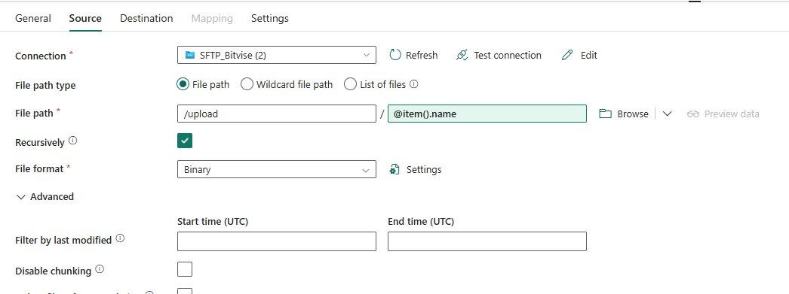

Destination — SFTP_Bitvise, path: /archive/@item().name, format: Binary:

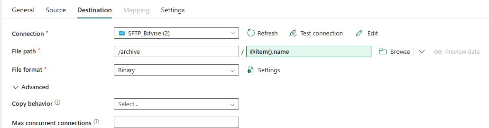

---

**Delete_from_Upload** (inside ForEach — after archive)

Deletes the original file from the SFTP upload folder after it has been successfully archived. This keeps the upload folder clean and prevents reprocessing on the next run.

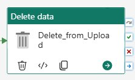

General settings:

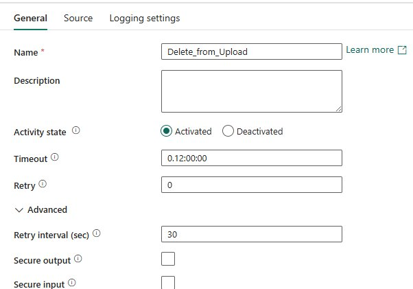

Source — SFTP_Bitvise, path: /upload/@item().name:

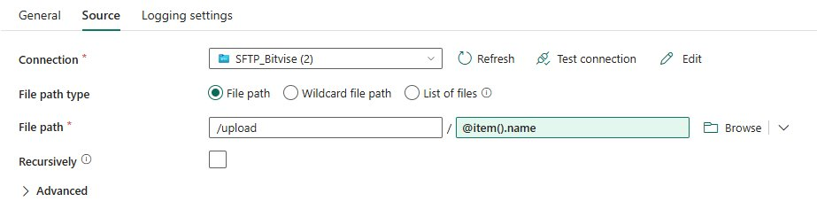

---

**NB_Audit_Log_Failed** (inside ForEach — failure branch)

Runs notebook NB_03_Audit_Log_Failed. Writes a failed row to the bronze_audit_log Delta table. The file remains in the upload folder so it will be retried on the next pipeline run.

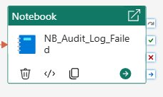

General settings:

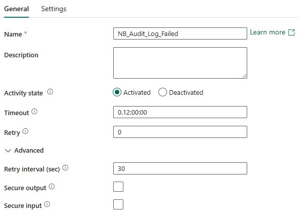

Settings — notebook: NB_03_Audit_Log_Failed. Parameters: p_pipeline_run_id, p_file_name, p_error_message:

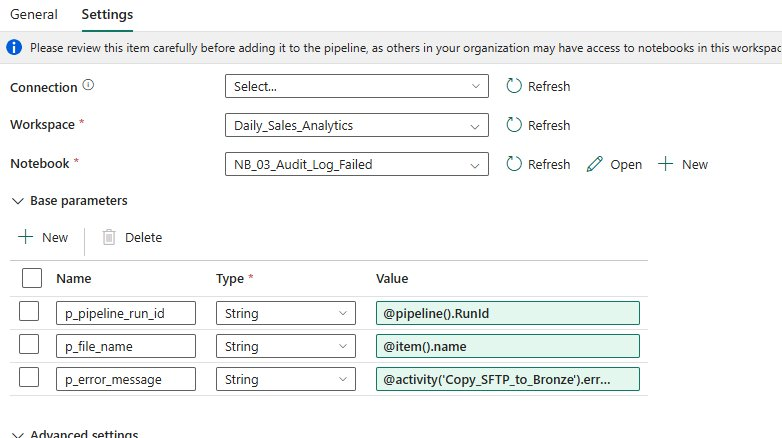

---

### Bronze Layer Results

**bronze_audit_log** — tracks every pipeline run per file, with status, error detail, file modified time, and the Bronze path where the file was landed:

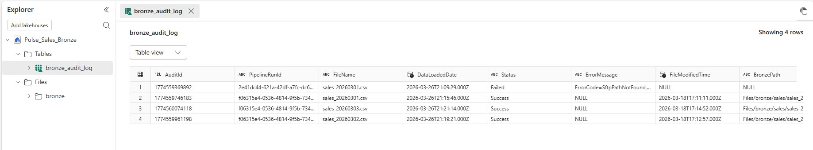

**Files/bronze/sales** — raw CSV files as landed from SFTP, no transformations applied:

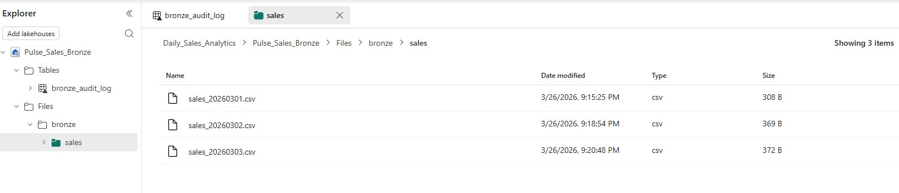

---

## Silver Layer — silver_layer_notebook

The Silver notebook reads all unprocessed CSV files from the Bronze Lakehouse, applies data quality rules, enriches the data, and writes cleaned records into the `sales_silver` Delta table.

It uses a watermark table to track which files have been processed. On each run it identifies only new or re-landed files and processes those. Previously processed files that have not changed are skipped.

### What the notebook does

**Step 1 — Identify pending files**

Cross-references `bronze_audit_log` against `silver_watermark`. A file is considered pending if it has never been processed, or if the Bronze load date is newer than the last Silver processed date (indicating the file was re-landed at source).

**Step 2 — Read with enforced schema**

Reads each pending CSV from the Bronze Files path using a defined schema. Malformed rows are handled in PERMISSIVE mode rather than aborting the run.

**Step 3 — Apply data quality rules**

The following rules are applied in sequence. Rejected row counts are recorded per rule:

- Drop rows where TransactionID is null
- Trim whitespace from all string columns
- Drop rows where Date, Quantity, or UnitPrice is null
- Drop rows where Quantity or UnitPrice is zero or negative
- Deduplicate on TransactionID, keeping the first occurrence

**Step 4 — Enrich**

- Calculate TotalRevenue as Quantity multiplied by UnitPrice
- Derive Year, Month, Day columns from Date
- Extract EmailDomain from CustomerEmail
- Mask CustomerEmail to `***@domain.com`
- Attach row-level audit columns: _source_file, _silver_loaded_at, _silver_run_id

**Step 5 — Load into sales_silver**

Deletes all existing rows for the source file from `sales_silver`, then inserts the complete fresh set. This handles both new files and re-landed files cleanly without creating duplicates.

**Step 6 — Update watermark and audit log**

Upserts the `silver_watermark` table with the file's processed status and row count. Appends a row to `silver_audit_log` with full run metrics including rows read, rejected, written, rejection detail, and duration.

### Silver Layer Results

**sales_silver** — 14 rows across 3 source files. Customer emails are masked. TotalRevenue, Year, Month, Day, and EmailDomain are derived columns:

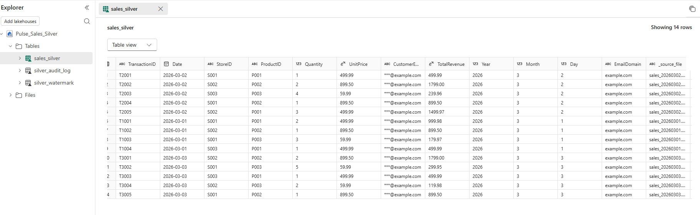

**silver_audit_log** — one row per file per run, recording rows read, rejected, written, and final status:

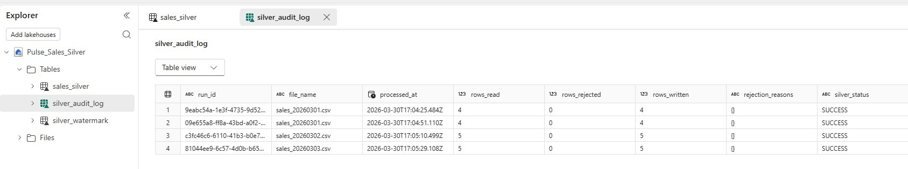

**silver_watermark** — tracks the processed status and timestamp for each file. Used on subsequent runs to skip already-processed files:

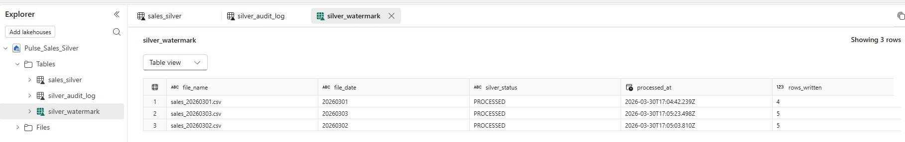

---

## Gold Layer — gold_layer_notebook

The Gold notebook reads from `sales_silver` and produces four aggregated Delta tables. All four tables are written in a single notebook run. A shared `gold_audit_log` table records the outcome for each table.

### Gold Tables

**gold_daily_store_revenue**

One row per Date and StoreID. Aggregates TotalRevenue, TransactionCount, TotalUnitsSold, AvgOrderValue, MaxOrderValue, MinOrderValue for each store each day.

Use cases: daily store trend analysis, store vs store comparison.

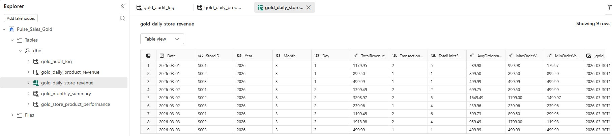

---

**gold_daily_product_revenue**

One row per Date and ProductID. Aggregates TotalRevenue, UnitsSold, TransactionCount, AvgUnitPrice, MaxUnitPrice, MinUnitPrice for each product each day.

Use cases: product performance ranking, daily product trend chart.

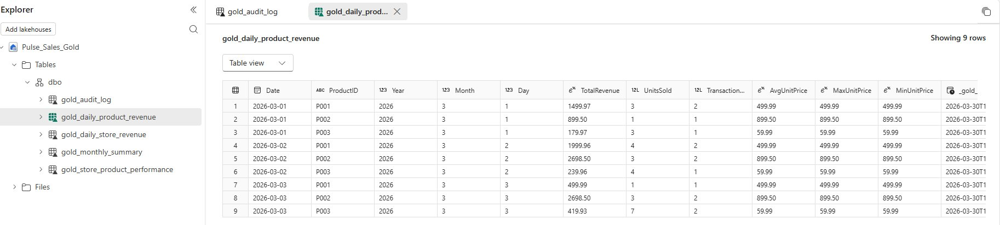

---

**gold_monthly_summary**

One row per Year and Month. Aggregates TotalRevenue, TotalTransactions, TotalUnitsSold, AvgOrderValue, MaxOrderValue, ActiveStores, ActiveProducts, TradingDays, and RevenuePerTradingDay.

Use cases: executive KPI cards, month-over-month trend line.

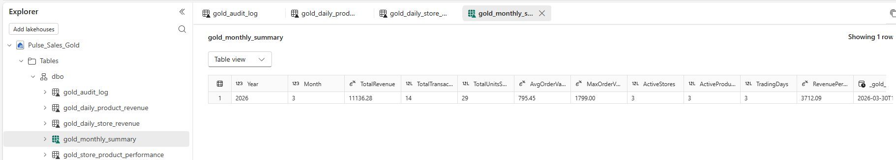

---

**gold_store_product_performance**

One row per StoreID, ProductID, Year, and Month. Includes a RevenueRankInStore column — the revenue rank of each product within its store for that month.

Use cases: store-product heatmap, top and bottom product analysis per store.

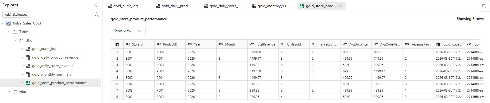

---

**gold_audit_log** — records outcome, row count, and duration for each of the four Gold tables per run:

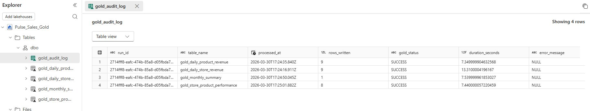

---

## Sample Data Schema

Source files follow this schema:

| Column | Type | Description |
|--------|------|-------------|
| TransactionID | String | Unique identifier for each transaction |
| Date | Date (YYYY-MM-DD) | Date of the transaction |
| StoreID | String | Store identifier |
| ProductID | String | Product identifier |
| Quantity | Integer | Number of units sold |
| UnitPrice | Decimal | Price per unit |
| CustomerEmail | String | Customer email address (masked in Silver) |

Sample files are in the `sample-data` folder.

---

## Repository Structure

```
fabric-sftp-medallion-pipeline/
|
|-- README.md
|
|-- notebooks/
|   |-- NB_02_Audit_Log_Success.ipynb     <- Bronze audit success logger
|   |-- NB_03_Audit_Log_Failed.ipynb      <- Bronze audit failure logger
|   |-- silver_layer_notebook.ipynb       <- Silver transformation notebook
|   |-- gold_layer_notebook.ipynb         <- Gold aggregation notebook
|
|-- sample-data/
|   |-- sales_20260301.csv
|   |-- sales_20260302.csv
|   |-- sales_20260303.csv
|
|-- screenshots/
    |-- 00_Daily_Sales_Analytics_Medallion_Task_flow.png
    |-- 00_Data_Source.png
    |-- 00_PL_Daily_Sales.png
    |
    |-- 01_Get_data/           <- Bronze pipeline — 30 screenshots
    |-- 02_Bronze_layer/       <- Bronze lakehouse output
    |-- 03_Silver_layer/       <- Silver lakehouse output
    |-- 04_Gold_layer/         <- Gold lakehouse output
```

---

## Tech Stack

| Component | Technology |
|-----------|------------|
| Cloud platform | Microsoft Fabric (Trial) |
| Pipelines | Fabric Data Factory |
| Notebooks | Fabric Spark (PySpark) |
| SFTP server | Bitvise SSH Server (free, Windows-native) |
| Gateway | On-premises Data Gateway |
| Storage | Microsoft OneLake (Delta / Parquet) |
| Source format | CSV |
| OS | Windows 11 |

---

## Prerequisites

- Microsoft Fabric workspace (free trial at app.fabric.microsoft.com)
- Windows 10 or 11 PC
- Bitvise SSH Server (free personal licence) — see [sftp-setup-for-fabric-ingestion](https://github.com/RevathyDevarajan/sftp-setup-for-fabric-ingestion)
- On-premises Data Gateway (free, from Microsoft)

---

*Built with Microsoft Fabric | Bitvise SSH Server | On-premises Data Gateway | PySpark | Delta Lake | Windows 11*
